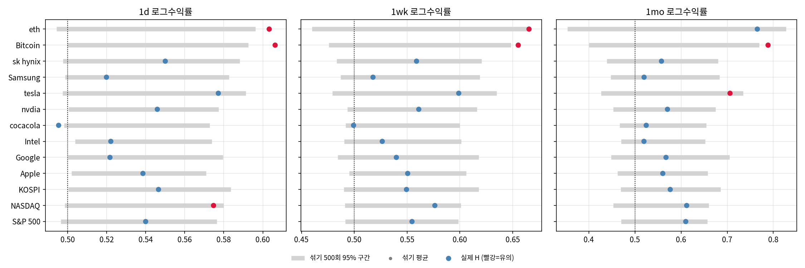
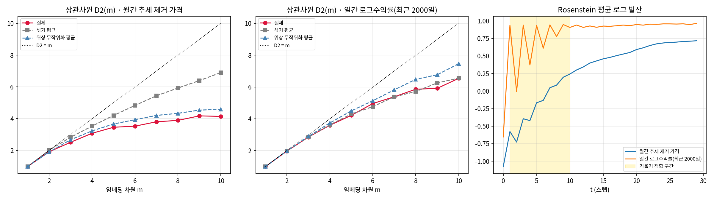

# market-memory

금융 시계열에 **기억(장기 의존성)** 이나 **저차원 비선형 구조(카오스)** 가 있는지 확인한 저장소.
2025-2 투자공학 과제(허스트 지수, 리아프노프 지수·상관차원)를 다시 계산하고, 원본에 없던 **통계적 비교 기준**을 붙였다.
숫자는 모두 `notebooks/` 실행 결과(`results/`)에서 가져왔다.

## 1. 문제

- 수익률이 랜덤워크(H = 0.5)와 다른가? 다르면 추세 지속(H > 0.5)인가 평균 회귀(H < 0.5)인가.
- 가격 변동이 적은 수의 변수로 움직이는 결정론적 비선형 계(카오스)인가, 아니면 잡음인가.

원본 과제는 "실제 값 vs 한 번 섞은 값"을 비교해 결론을 냈다. 섞기 한 번은 우연에 따라 값이 크게 달라진다. 그래서 **비교 기준을 분포로 바꾸는 것**이 이 저장소의 핵심이다.

## 2. 데이터

| 분석 | 대상 | 주기 | 기간 |
|---|---|---|---|
| 허스트 지수 | S&P 500, NASDAQ, KOSPI, Apple, Google, Intel, Coca-Cola, NVIDIA, Tesla, 삼성전자, SK하이닉스, Bitcoin, Ethereum | 일·주·월 로그수익률 | 상장·시작일 – 2024-12 (S&P 500 일간 11,343개 … Ethereum 월간 85개) |
| 상관차원·리아프노프 | 금 선물(GC=F), 미국 CPI(FRED CPIAUCSL) | 월간 추세 제거 가격 / 일간 로그수익률 | 2000-08 – 2025-08 (N=301) / 2017-10-30 – 2025-10-13 (N=2,000) |

출처: Yahoo Finance 종가, FRED. 원본 과제에서 받은 CSV를 쓴다. 데이터는 저장소에 넣지 않으며 `scripts/download_data.py`로 다시 받을 수 있다(재다운로드 시 수정주가 갱신으로 값이 조금 달라질 수 있다).

## 3. 방법

### 3-1. 허스트 지수 (R/S 분석)

| 단계 | 내용 | 이유 |
|---|---|---|
| R/S 계산 | 로그수익률을 구간 크기 10 – n/2(로그 간격 20개)로 나눠 구간별 재조정 범위 R/S의 평균을 구하고, log(R/S) – log(구간 크기) 기울기를 H로 둔다 | 원본과 같은 방법. 원본 값 재현을 먼저 확인한다 |
| 비교 기준 | 수익률 순서를 **500번** 섞어 H의 귀무분포(기억 없음)를 만든다. p값 = 섞은 H가 실제 H 이상인 비율(단측) | 섞어도 분포는 같고 시간 순서만 사라진다. R/S는 표본이 작으면 0.5보다 크게 나오는 편향이 있어서, 0.5가 아니라 이 분포와 비교해야 한다 |

### 3-2. 상관차원·리아프노프 지수

| 단계 | 내용 | 이유 |
|---|---|---|
| 추세 제거 | 금 월간 로그가격을 log CPI와 시간 추세에 회귀한 잔차 | 원본과 같은 전처리. 물가·장기 추세를 빼고 남은 변동만 본다 |
| 상관차원 D2(m) | 지연 임베딩(m = 1 – 10), 체비쇼프 거리 상관적분 C(r)의 log-log 기울기(C가 0.001 – 0.1인 구간) | 결정론적 계면 m이 커져도 D2가 일정 값에서 포화하고, 잡음이면 m을 따라 계속 증가한다 |
| 최대 리아프노프 지수 | Rosenstein(1993): 최근접 이웃 궤적의 평균 로그 발산 기울기(m=5, τ=2, t = 1 – 10) | 양수면 초기 조건에 민감(카오스의 필요조건) |
| 비교 기준 | 대리계열 19개씩 두 종류: **섞기**(원본 방식)와 **위상 무작위화**(추가) | 섞기는 자기상관까지 없앤다. 위상 무작위화는 자기상관(파워 스펙트럼)을 그대로 두고 비선형 구조만 없앤다. 실제 계열이 위상 무작위화와도 달라야 비선형 구조의 증거가 된다. 19개 순위 검정의 최소 p = 0.05 |

**실행 전에 기대한 결과**
- 지수·대형주는 H가 귀무분포와 구별되지 않을 것(효율적 시장). 가상자산처럼 역사가 짧고 개인 비중이 큰 자산은 H가 높을 수 있다.
- 금의 추세 제거 가격은 섞은 계열보다 D2가 낮겠지만, 자기상관이 강한 계열이라 그 차이 대부분은 선형 자기상관 때문일 것.

## 4. 결과

### 4-1. 원본 재현

- 원본 PPT의 R/S 값 26개(주·월 × 13자산) 중 **24개가 소수 넷째 자리까지 같다**. SK하이닉스 2개만 차이(주간 0.5336→0.5590, 월간 0.5320→0.5575). 원인은 확인하지 못했다.
- 원본의 "한 번 섞은 값" 26개 중 25개가 500회 섞기 95% 구간 안에 있다. 즉 한 번 섞은 값은 우연의 범위 안에서 흔들린 값이다.

### 4-2. 허스트 지수 (`results/hurst_summary.md`)

표 값: H (섞기 500회 평균, 단측 p). `*` = p < 0.05.

| 자산 | 일간 | 주간 | 월간 |
|---|---|---|---|
| S&P 500 | 0.540 (0.537, 0.465) | 0.555 (0.548, 0.397) | 0.610 (0.565, 0.198) |
| NASDAQ | 0.575 (0.538, 0.036) * | 0.576 (0.548, 0.152) | 0.612 (0.562, 0.164) |
| KOSPI | 0.547 (0.542, 0.411) | 0.549 (0.552, 0.527) | 0.577 (0.569, 0.439) |
| Apple | 0.539 (0.537, 0.463) | 0.551 (0.549, 0.451) | 0.560 (0.560, 0.513) |
| Google | 0.522 (0.541, 0.808) | 0.540 (0.557, 0.689) | 0.567 (0.573, 0.547) |
| Intel | 0.522 (0.537, 0.770) | 0.527 (0.547, 0.768) | 0.520 (0.562, 0.806) |
| Coca-Cola | 0.495 (0.537, 0.976) | 0.499 (0.546, 0.956) | 0.524 (0.567, 0.828) |
| NVIDIA | 0.546 (0.540, 0.393) | 0.561 (0.552, 0.371) | 0.571 (0.567, 0.485) |
| Tesla | 0.577 (0.546, 0.106) | 0.599 (0.558, 0.158) | 0.706 (0.576, 0.044) * |
| 삼성전자 | 0.520 (0.542, 0.832) | 0.518 (0.552, 0.846) | 0.520 (0.566, 0.770) |
| SK하이닉스 | 0.550 (0.542, 0.347) | 0.559 (0.551, 0.391) | 0.558 (0.568, 0.597) |
| Bitcoin | 0.606 (0.547, 0.006) * | 0.655 (0.563, 0.014) * | 0.789 (0.583, 0.020) * |
| Ethereum | 0.603 (0.548, 0.014) * | 0.666 (0.568, 0.028) * | 0.765 (0.582, 0.070) |

- **섞은 계열의 H 평균이 0.5보다 높다**: 일간 0.541, 주간 0.553, 월간 0.569(13자산 평균). R/S의 소표본 편향이다. 0.5와 비교하면 기억이 있는 것처럼 보인다.
- 원본은 S&P 500(월간 0.6102)·KOSPI(0.5765)가 "biased random walk"라고 결론냈다. 귀무분포와 비교하면 p = 0.198, 0.439로 **구별되지 않는다**.
- 39개 검정 중 7개가 p < 0.05다(우연만으로 기대되는 수 39 × 0.05 = 1.95개). Bitcoin은 세 주기 모두, Ethereum은 일·주간에서 유의했다. 가상자산의 추세 지속성은 비교 기준을 바꿔도 남는다.



회색 막대는 섞기 500회의 양측 95% 구간이고, 빨간 점은 단측 p < 0.05다.

### 4-3. 상관차원·리아프노프 지수 (`results/chaos_summary.md`)

| 계열 | N | D2(m=10) 실제 | 섞기 평균 | 위상 무작위화 평균 | p(위상보다 작음) | λ 실제 | λ 위상 평균 | p(λ가 위상보다 큼) |
|---|---|---|---|---|---|---|---|---|
| 월간 추세 제거 가격 | 301 | 4.14 | 6.90 | 4.59 | 0.10 | 0.1072 | 0.0974 | 0.25 |
| 일간 로그수익률 | 2,000 | 6.54 | 6.56 | 7.46 | 0.05 | 0.0423 | 0.0434 | 0.95 |

- **월간 추세 제거 가격**: 섞은 계열보다는 D2가 낮고(m = 3 – 10에서 모두 p = 0.05) λ가 크다(0.1072 vs 섞기 평균 0.0371, p = 0.05). 원본 결론("섞으면 차원이 계속 늘고 실제는 포화")과 같은 모습이다. 하지만 위상 무작위화 계열과 비교하면 D2(p = 0.10), λ(p = 0.25) 모두 구별되지 않는다. **차이는 비선형 구조가 아니라 선형 자기상관으로 설명된다.**
- **일간 로그수익률**: D2가 섞은 계열과 같다(6.54 vs 6.56). 위상 무작위화 계열보다는 낮은데(p = 0.05), 섞기와는 차이가 없으므로 시간 구조가 아니라 분포 차이(위상 무작위화는 분포를 정규분포 쪽으로 바꾸고, 실제 수익률은 꼬리가 두껍다)로 보는 것이 맞다. 로그 발산이 첫 스텝에서 바로 포화해 λ 기울기는 의미가 없다.
- 결론: 금 가격에서 **저차원 카오스의 증거는 찾지 못했다.**



## 5. 한계

- **다중 검정**: 허스트 39개, D2 m별 10개를 따로 검정했다. 보정하지 않았다.
- **R/S의 약점**: 단기 자기상관에도 H가 오른다. 수정 R/S(Lo, 1991)나 DFA로 교차 확인하지 않았다.
- **대리계열**: 위상 무작위화는 분포까지 바꾼다. 분포를 보존하는 IAAFT 대리계열이 더 엄밀하다. 대리계열 19개라 p값 해상도가 0.05다.
- **표본 길이**: 월간 금 301개, Ethereum 월간 85개. 상관차원은 짧은 계열에서 낮게 나오는 편향이 있다.
- **파라미터 선택**: 임베딩 지연 τ, 적합 구간(C 0.001 – 0.1, t 1 – 10)을 고정값으로 썼고 상호정보량·FNN으로 정하지 않았다.
- **원본 대비 변경**: 원본의 리아프노프 값(0.00121)은 무작위 표본 추출 방식이라 재현되지 않는다. 여기서는 원본 `lyapunov.py`의 Rosenstein 방법을 썼다.

## 6. 재현

```bash
pip install -r requirements.txt
python scripts/download_data.py     # data/raw/ 생성 (yfinance, FRED)
bash scripts/run_all.sh             # 테스트 13개 → 노트북 2개 실행 → results/ 갱신
```

테스트는 R/S 벡터화가 반복문 구현과 같은지, 원본 값 재현, 로지스틱 사상(λ > 0, 낮은 D2)과 백색잡음(높은 D2) 구분, 위상 무작위화의 스펙트럼 보존을 확인한다. 설정은 [`configs/base.yaml`](configs/base.yaml)에 있다.

## 7. AI 도구 사용 범위

| 단계 | 도구 | 범위 |
|---|---|---|
| 원본 과제 | 직접 작성 (확인 필요) | R/S 함수, Rosenstein `lyapunov.py`, 상관적분, CPI 추세 제거 |
| 이 저장소 | Claude | 원본 재현 코드 정리·벡터화, 섞기 500회 귀무분포, 위상 무작위화 대리계열, 테스트·노트북·문서 초안. 결과 수치는 모두 코드 실행 출력 |
